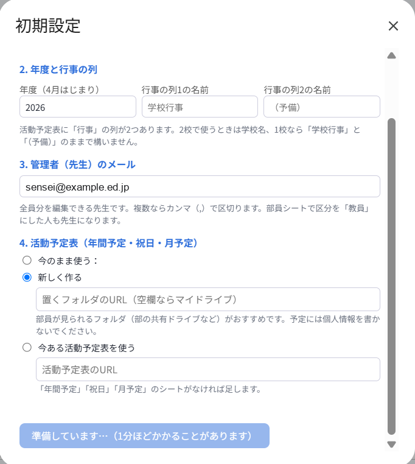
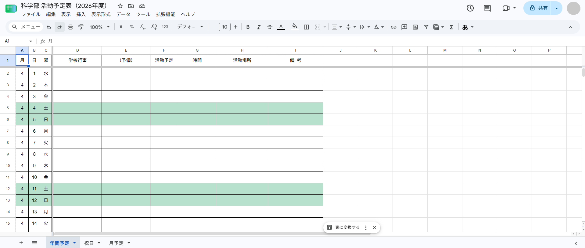
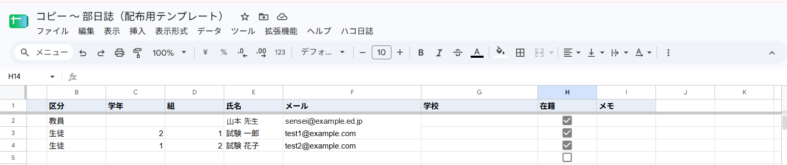
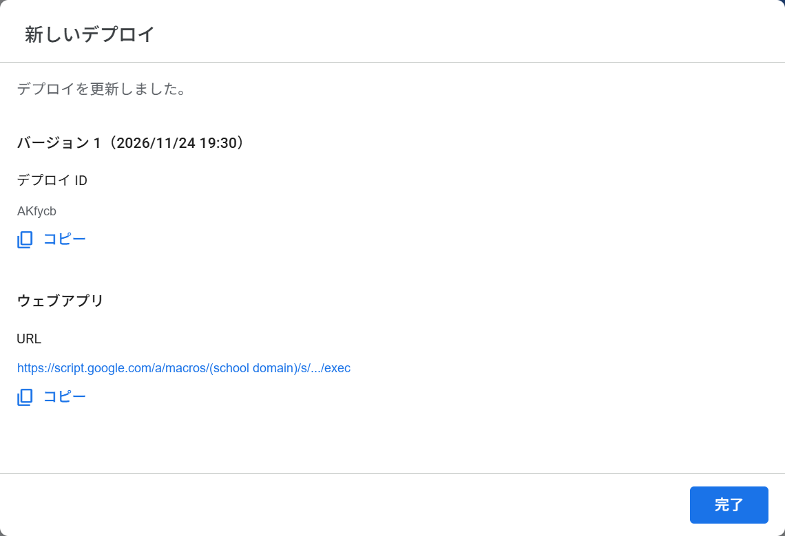
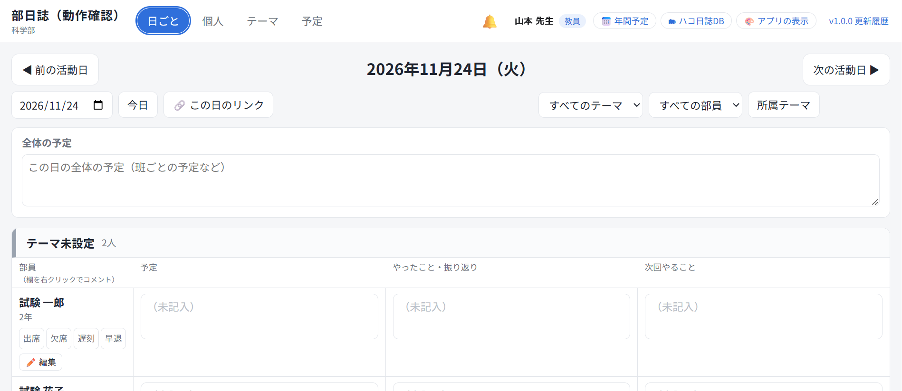

# 2. 導入（20分ほど）

**すべて、学校の Google アカウントで行います。** 個人のアカウントでは、部員が使えません。

## 1. テンプレートをコピーする
1. [ハコ日誌のテンプレート](（公開時に入れます）) を開き、「コピーを作成」を押す
2. コピーの名前を変える（例：`ハコ日誌DB_科学部`）
3. 必要なら、Google ドライブで**先生だけの共有ドライブ**に移す（マイドライブのままでもかまいません）
   - **生徒がメンバーの共有ドライブには置かないでください**（[1. はじめに](01-hajimeni.md#ファイルと置き場所)）

## 2. 初期設定
1. コピーを開き、メニュー「**ハコ日誌**」→「**初期設定（最初にここから）**」
   - メニューが出るまで、数秒かかります
2. 「承認が必要です」と出たら「続行」→ 自分のアカウント →「許可」
   - 「Google で確認されていません」と出たときは、「詳細」→「（プロジェクト名）に移動」
3. 承認のあと、もう一度「ハコ日誌」→「初期設定（最初にここから）」
4. 初期設定の画面に入れる

| 欄 | 入れるもの |
|---|---|
| アプリ名・団体名 | 画面に出す名前（例：ハコ日誌／〇〇中学校 科学部）。あとでアプリの画面から変えられます |
| 年度 | 4月はじまりの年度（例：2026） |
| 行事の列の名前 | 活動予定表の「行事」の列の見出し。ふつうは「学校行事」と「（予備）」のままでかまいません |
| 管理者（先生）のメール | 全員分を直せる先生の学校アカウント。複数ならカンマ（,）で区切る |
| 活動予定表 | ふつうは「**新しく作る**」。置くフォルダ（部員と使うフォルダ）の URL を入れる。空欄ならマイドライブにでき、あとで移せます |

5. 「保存して準備する」（1分ほどかかります）。次のことが行われます
   - 活動予定表（年間予定・祝日・月予定のシート）を作る
   - 活動日を読み込み、1時間ごとの自動の読み込みを設定する
   - ハコ日誌DB に「はじめに」シート（置き場所のきまりと導入のチェック表）を作る

作られた活動予定表は、次のようになります（土日・祝日に色が付きます）。

活動予定表をマイドライブに作ったときは、部員と使うフォルダへ移すか、部員に「閲覧者」で共有してください。部員もアプリの「📅 年間予定」から開きます。

## 3. 部員の名簿を入れる
ハコ日誌DB の「**部員**」シートに、1人1行で入れます。

| 列 | 入れるもの |
|---|---|
| 部員ID | 重ならない記号（例：M001、M002…）。一度決めたら変えない |
| 区分 | 「生徒」か「教員」 |
| 学年・組 | 数字（教員は空欄） |
| 氏名 | 例：山田 花子 |
| メール | **学校のアカウント**（本人の確認に使います） |
| 学校 | 空欄でかまいません |
| 在籍 | **チェックボックス**に ✓。卒業・退部したら ✓ を外す（記録は残ります） |

- チェックボックスは、在籍の列のセルを選んで「挿入」→「チェックボックス」で作れます
- 名簿は、あとからいつでも足せます

## 4. ウェブアプリとして公開する
1. メニュー「拡張機能」→「Apps Script」
2. 右上「デプロイ」→「新しいデプロイ」→ 種類の歯車で「ウェブアプリ」
3. 次のユーザーとして実行：**自分**
4. アクセスできるユーザー：**（学校のドメイン）内の全員**
5. 「デプロイ」→ 承認が出たら「許可」
6. 出てきた「ウェブアプリ」の URL（`…/exec`）を控える。これが**アプリの URL** です

## 5. アプリを開いて準備する
1. アプリの URL を開く。左上にアプリ名、右上に自分の名前と「教員」の印が出ます
2. 「⚠ 確認してください」が出たら、書いてあるとおりに直す（置き場所など）
3. 「**テーマ**」タブ →「⚙ テーマを管理」で、テーマ（班）を作る（例：ロボット、水質調査）
4. 「日ごと」の「所属テーマ」で、部員をテーマに入れる（部員が自分で選ぶこともできます）

## 6. 部員に知らせる
- アプリの URL を、Classroom などで部員に知らせる
- 部員は、最初に「所属テーマ」で自分の班を選びます（複数でもかまいません）
- 使い方は [3. ふだんの使い方と管理](03-kanri.md) を見てください

## うまくいかないとき
- メニュー「ハコ日誌」が出ない → スプレッドシートを開き直す。それでも出ないときは、拡張機能 → Apps Script で、コード.gs があるか確かめる
- 「ファイルを開くことができません」と出る → ブラウザに複数のアカウントでログインしているためです。学校のアカウントだけのブラウザ（Chrome のプロファイル）で開く
- 先生として扱われない → 部員シートで区分を「教員」にしてメールを入れるか、設定シートの「管理者メール」に入れる
- 部員が一覧に出ない → 部員シートの「在籍」に ✓ が入っているか、区分が「生徒」になっているか
